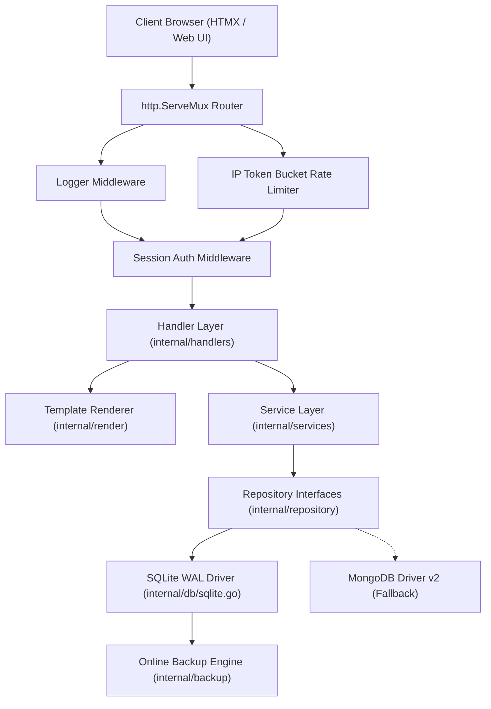

# Architecture & Routing Reference Guide

This document details the internal architecture, request handling lifecycle, dependency injection model, middleware pipeline, backup scheduler, and template rendering system of the **Wedrink EOD Report System**.

---

## 1. Application Layer Hierarchy & Package Responsibilities

The codebase strictly adheres to **Clean Architecture** separation of concerns using Go standard library components and pure Go libraries (zero CGO):



### Layer Breakdown

1. **Entry Point (`cmd/server/main.go`)**:
   - Reads environment configuration using `internal/config`.
   - Initializes structured logging with `internal/utils`.
   - Conditionally initializes either SQLite (`internal/db.ConnectSQLite`) or MongoDB (`internal/db.Connect`) based on `cfg.DBDriver`.
   - Starts the background backup cron runner goroutine if `cfg.BackupEnabled && cfg.DBDriver == "sqlite"`.
   - Constructs repositories conforming to `internal/repository` interfaces (`UserRepo`, `ReportRepo`, `NotificationRepo`, `AuditRepo`).
   - Seeds default demo accounts on a fresh database.
   - Instantiates domain services (`AuthService`, `ReportService`, `NotificationService`, `AuditService`).
   - Registers template helper functions (`FuncMap`) and constructs `render.Renderer`.
   - Sets up HTTP router (`http.NewServeMux`) using Go 1.22+ path patterns.
   - Starts HTTP server with graceful shutdown handling on `SIGINT` / `SIGTERM`.

2. **Configuration (`internal/config/config.go`)**:
   - Parses `.env` key-value pairs manually using a robust scanner.
   - Candidate search: Discovers `.env` across current working directory and executable parent directories.
   - Preserves OS environment variables: Pre-existing environment variables (e.g. from CLI or PM2) are preserved over `.env` values.
   - Strips enclosing quotes (`"` or `'`) from values.
   - Intelligent path resolution: If relative paths (`SQLITE_PATH` or `BACKUP_DIR`) do not exist in the current working directory, it automatically resolves them relative to the executable's application root (`filepath.Dir(filepath.Dir(exe))`).
   - Production recommendation: Use absolute paths (e.g. `SQLITE_PATH=/home/luyce/wedrink/data/wedrink.db`) to avoid PM2 `cwd` drift.
   - Keys supported:
     - `PORT`: Default `8080`
     - `DB_DRIVER`: `"sqlite"` (recommended) or `"mongodb"` (default fallback when unset in `.env` to prevent unmigrated boots)
     - `SQLITE_PATH`: Default `data/wedrink.db`
     - `BACKUP_ENABLED`: Default `true`
     - `BACKUP_INTERVAL`: Default `24h`
     - `BACKUP_DIR`: Default `data/backups`
     - `BACKUP_RETENTION`: Default `14`
     - `SESSION_SECRET`: Default `wedrink-secret-session-key-2026-change-me`
     - `ENV`: Default `development`

3. **HTTP Middleware Pipeline (`internal/middleware/`)**:
   - **`SessionManager.AuthMiddleware`**: Decodes `wedrink_session` cookie (`username|role|fullname`). Injects `*models.User` into `r.Context()`.
   - **`RequireAuth`**: Verifies user presence in context. Unauthenticated requests redirect to `/login` (with `HX-Redirect: /login` for HTMX).
   - **`RequireRole`**: High-order middleware checking user roles (`models.RoleStaff`, `models.RoleSuperAdmin`).
   - **`RateLimiter`**: Per-IP token bucket rate limiting protecting authentication and submission endpoints.
   - **`Logger`**: Structured request logging via `log/slog`.

---

## 2. Full HTTP Route Map

| Method | Path | Access Level | Handler Function | Response Type |
| --- | --- | --- | --- | --- |
| `GET` | `/static/` | Public | Standard FileServer | Static file stream with `no-cache` dev headers |
| `GET` | `/health` | Public | Inline JSON func | JSON status object |
| `GET` | `/login` | Public | `AuthHandler.RenderLogin` | Full HTML page (`login.html`) |
| `POST` | `/login` | Public | `AuthHandler.HandleLogin` | Form redirect or HTMX redirect header |
| `POST` | `/logout` | Authenticated | `AuthHandler.HandleLogout` | Clears cookie, redirects to `/login` |
| `GET` | `/{$}` | Authenticated | `DashboardHandler.RenderDashboard` | Full HTML page (`dashboard.html` + `dashboard_content.html`) |
| `GET` | `/submit` | Authenticated | `ReportHandler.RenderSubmitForm` | Full HTML page (`submit.html`) |
| `POST` | `/reports/preview` | Authenticated | `ReportHandler.RenderCalculationPreview` | HTMX Fragment (`calculation_preview.html`) |
| `GET` | `/reports/expense-row` | Authenticated | `ReportHandler.RenderExpenseRow` | HTMX Fragment (`expense_row.html`) |
| `POST` | `/reports` | Authenticated | `ReportHandler.HandleSubmit` | HTMX Fragment (`alert_success.html` / `alert_error.html`) |
| `GET` | `/reports` | Manager Only | `ReportHandler.RenderReportsList` | Full HTML (`reports.html`) or HTMX table (`report_table.html`) |
| `GET` | `/reports/detail` | Manager Only | `ReportHandler.RenderDetailModal` | HTMX Fragment (`report_modal.html`) |
| `GET` | `/reports/edit` | Manager Only | `ReportHandler.RenderEditForm` | Full HTML page (`submit.html` populated for edit) |
| `DELETE` / `POST` | `/reports/delete` | Manager Only | `ReportHandler.HandleDelete` | Password verified deletion |
| `GET` | `/export/csv` | Manager Only | `ExportHandler.ExportCSV` | File attachment `text/csv` |
| `GET` | `/admin/audit` | Manager Only | `AuditHandler.RenderAuditList` | Full HTML page (`audit.html`) |
| `GET` | `/admin/audit/detail` | Manager Only | `AuditHandler.RenderAuditDetail` | HTMX Fragment modal |

---

## 3. Dependency Injection & Service Composition

In `main.go`, dependencies are wired sequentially:

```go
// 1. Storage Driver Selection
if cfg.DBDriver == "sqlite" {
    sqliteDB, _ := db.ConnectSQLite(cfg.SQLitePath)
    userRepo = repository.NewSQLiteUserRepository(sqliteDB)
    reportRepo = repository.NewSQLiteReportRepository(sqliteDB)
    notifRepo = repository.NewSQLiteNotificationRepository(sqliteDB)
    auditRepo = repository.NewSQLiteAuditRepository(sqliteDB)

    // Background Backup Scheduler
    if cfg.BackupEnabled {
        go backup.StartScheduler(context.Background(), sqliteDB, cfg.BackupDir, cfg.BackupInterval, cfg.BackupRetention)
    }
} else {
    mongoDB, _ := db.Connect(cfg)
    userRepo = repository.NewUserRepository(mongoDB.Database)
    reportRepo = repository.NewReportRepository(mongoDB.Database)
    notifRepo = repository.NewNotificationRepository(mongoDB.Database)
    auditRepo = repository.NewAuditRepository(mongoDB.Database)
}

// 2. Domain Services
authService := services.NewAuthService(userRepo)
reportService := services.NewReportService(reportRepo)
notifService := services.NewNotificationService(notifRepo)
auditService := services.NewAuditService(auditRepo)
```
